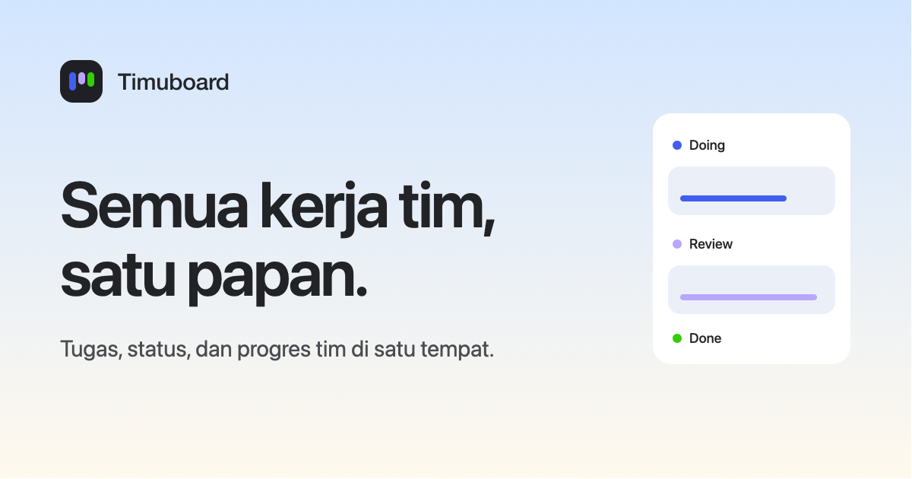

# Timuboard

**A real-time shared board for small teams.** Tasks, status, progress, and people in one view, so everyone knows who is working on what without asking in the group chat.

[Live app](https://timuboard.timulabs.dev) · [Try the playground](https://timuboard.timulabs.dev/en/playground) · [API docs](#api-documentation)



## Features

- **Live boards.** Every change shows up instantly for everyone on the board, with live cursors and presence.
- **Task workflow.** Columns for To do, Doing, Review, and Done, with drag and drop, assignees, priorities, due dates, tags, progress, and pinned tasks.
- **Comments and notifications.** Discuss tasks in place and get notified when you are assigned, someone comments on your task, a task needs your review, or you are added to a board.
- **Roles.** Board owner, admins, and members, each with clear permissions.
- **Accounts.** Email sign-up with verification, password reset, and Google Sign-In.
- **Guest playground.** A public demo board anyone can try without an account.
- **Bilingual and themed.** Indonesian and English UI, light and dark mode.

## Tech stack

| Layer | Technology |
|---|---|
| Frontend | [React 19](https://react.dev), [TypeScript](https://www.typescriptlang.org), [Vite](https://vite.dev), [React Router 7](https://reactrouter.com) |
| UI | [Tailwind CSS 4](https://tailwindcss.com), [shadcn/ui](https://ui.shadcn.com) on [Radix UI](https://www.radix-ui.com), [Lucide](https://lucide.dev) icons, [GSAP](https://gsap.com) animation, [dnd kit](https://dndkit.com) drag and drop |
| Backend | [NestJS 11](https://nestjs.com), [TypeORM](https://typeorm.io), [Passport](https://www.passportjs.org) + JWT, [class-validator](https://github.com/typestack/class-validator), [Helmet](https://helmetjs.github.io) |
| Realtime | [Socket.IO](https://socket.io) with the Redis adapter and emitter, so broadcasts work across instances |
| Data | [PostgreSQL 16](https://www.postgresql.org), [Redis 7](https://redis.io) (rate limiting, realtime fan-out, playground state) |
| Email | [Nodemailer](https://nodemailer.com), [Mailpit](https://mailpit.axllent.org) for local development |
| API docs | OpenAPI via [@nestjs/swagger](https://docs.nestjs.com/openapi/introduction) |
| Testing | [Jest](https://jestjs.io), [Supertest](https://github.com/ladjs/supertest), end-to-end tests against real Postgres and Redis |
| Infrastructure | Docker, [Caddy](https://caddyserver.com) (HTTPS), GitHub Actions, GitHub Container Registry, [Vercel](https://vercel.com) (frontend) |

## Architecture

```
Browser ──HTTPS──▶ Vercel (React SPA)
   │
   ├──REST + Socket.IO──▶ Caddy ──▶ NestJS API ──▶ PostgreSQL
   │                                    │
   │                                    └────────▶ Redis
```

Writes go through REST. The API then broadcasts the result over Socket.IO to everyone viewing the board, and Redis relays those broadcasts between API instances.

## Getting started

### Prerequisites

- Node.js 20+
- Docker with Docker Compose

### 1. Configure the environment

```bash
cp .env.example .env
```

Set `JWT_ACCESS_SECRET` in `.env` (for example, `openssl rand -hex 32`). Everything else works out of the box.

### 2. Run it

**Option A: everything in Docker**

```bash
docker compose -f docker-compose.yml -f docker-compose.dev.yml up --build
```

**Option B: infrastructure in Docker, apps on your machine** (faster reloads)

```bash
docker compose up -d postgres redis mailpit adminer

cd backend-timuboard && npm install && npm run start:dev
cd frontend-timuboard && npm install && npm run dev
```

### 3. Open it

| Service | URL |
|---|---|
| App | http://localhost:5173 |
| API | http://localhost:3000 (health check at `/health`) |
| API docs (Swagger) | http://localhost:3000/docs |
| Mailpit inbox | http://localhost:8025 |
| Adminer (database UI) | http://localhost:8080 |

Sign-up emails, including verification links, land in the Mailpit inbox.

## Scripts

| Directory | Command | Description |
|---|---|---|
| `backend-timuboard` | `npm run start:dev` | Start the API in watch mode |
| | `npm test` | Unit tests |
| | `npm run test:e2e` | End-to-end tests (needs Postgres, Redis, and Mailpit running) |
| | `npm run lint` | Lint and fix |
| | `npm run migration:run` | Apply database migrations |
| `frontend-timuboard` | `npm run dev` | Start the Vite dev server |
| | `npm run build` | Type-check and build for production |
| | `npm run lint` | Lint |

## API documentation

- **REST:** every endpoint is documented with OpenAPI, including request and response shapes, error codes, and rate limits. Open http://localhost:3000/docs while the API is running, or export the spec from `/docs-json`. In production, Swagger is enabled only when `SWAGGER_ENABLED=true`.
- **Realtime:** the Socket.IO events for boards and the guest playground are described in [docs/realtime.md](docs/realtime.md).

## Project structure

```
.
├── backend-timuboard/     NestJS API
│   ├── src/               auth, boards, tasks, comments, notifications, realtime, playground, …
│   └── test/              end-to-end tests
├── frontend-timuboard/    React app
│   └── src/               pages, components, hooks, lib, data
├── proxy/                 Caddy reverse proxy (production)
├── docs/                  deployment and realtime protocol
├── docker-compose.yml     Postgres, Redis, Mailpit, Adminer
├── docker-compose.dev.yml Development overrides (API and frontend in Docker)
└── docker-compose.prod.yml Production backend stack
```

## Deployment

The frontend deploys to Vercel on every push to `master`. The backend is built by GitHub Actions, pushed to GitHub Container Registry, and rolled out to a VPS behind Caddy, followed by a health check. See [docs/DEPLOY.md](docs/DEPLOY.md) for the full setup.
